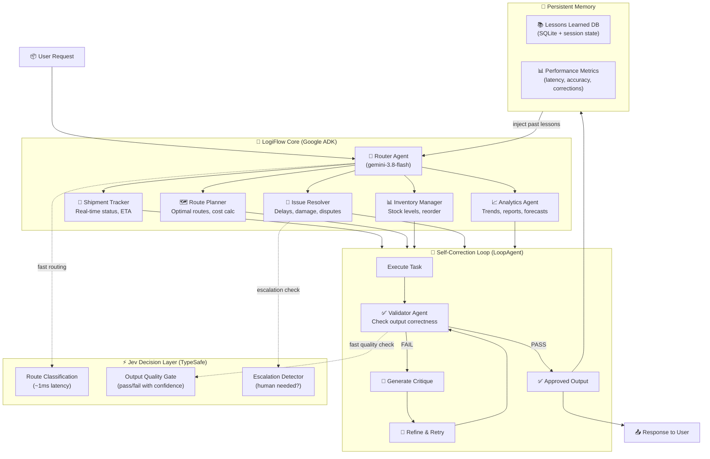

# LogiFlow — Self-Correcting Logistics Handler Agent

## Architecture



## What Makes LogiFlow Stand Out

### 1. Dual-Brain Architecture
- **Gemini (System 2)** — deep reasoning, planning, generation via Google ADK
- **Jev (System 1)** — instant classification, routing, quality gates at ~1ms
- Result: **blazing fast routing + deep reasoning where it matters**

### 2. Self-Correcting Feedback Loop
- Uses ADK's **LoopAgent** for Generate → Validate → Critique → Refine cycles
- **Max 3 iterations** (bounded cost/latency)
- Validator uses **deterministic checks + Jev quality scoring** (not just LLM self-eval)

### 3. Persistent Learning
- Every correction is logged with **why it failed** and **how it was fixed**
- Lessons injected into agent context on future runs via `output_key` session state
- Agent gets smarter over time — same mistake never repeated

### 4. 5 Specialist Agents
| Agent | Handles | Tools |
|---|---|---|
| **Shipment Tracker** | Tracking, status updates, ETA calculation | `track_shipment`, `calculate_eta` |
| **Route Planner** | Route optimization, cost estimation | `calculate_route`, `estimate_cost` |
| **Inventory Manager** | Stock levels, reorder alerts, warehouse ops | `check_inventory`, `reorder_stock` |
| **Issue Resolver** | Delays, damages, disputes, refunds | `log_issue`, `generate_resolution` |
| **Analytics Agent** | Reports, trends, KPI dashboards | `run_python_code`, `generate_report` |

### 5. End-to-End Logistics Coverage
- Shipment tracking (create, track, update, cancel)
- Route optimization (multi-stop, cost vs speed)
- Inventory management (stock levels, reorder points, warehouse allocation)
- Issue resolution (delays, damages, lost packages, disputes)
- Analytics & reporting (daily summaries, trend analysis, KPI tracking)

## Tech Stack
| Layer | Technology |
|---|---|
| Agent Framework | Google ADK 2.12.0 (`LlmAgent`, `LoopAgent`, `SequentialAgent`) |
| LLM | Gemini 3.8 Flash (primary), OpenAI GPT-4o-mini (fallback) |
| Decision Engine | TypeSafe Jev (System 1 routing + quality gates) |
| Memory | SQLite via ADK session state + `output_key` propagation |
| Runtime | Python 3.13, uv |

## File Structure
```
~/ssa/devfest-agent/
├── logiflow/                    # Main agent package
│   ├── __init__.py
│   ├── agent.py                 # Root pipeline (SequentialAgent)
│   ├── router.py                # Smart router with Jev fast-path
│   ├── specialists/
│   │   ├── tracker.py           # Shipment tracking agent
│   │   ├── planner.py           # Route planning agent
│   │   ├── inventory.py         # Inventory management agent
│   │   ├── resolver.py          # Issue resolution agent
│   │   └── analytics.py         # Analytics & reporting agent
│   ├── feedback/
│   │   ├── validator.py         # Output validation agent
│   │   ├── loop.py              # LoopAgent feedback cycle
│   │   └── memory.py            # Persistent lesson storage
│   ├── tools/
│   │   ├── logistics.py         # Domain-specific tools
│   │   ├── calculation.py       # Math, ETA, cost tools
│   │   └── data.py              # Data processing tools
│   └── jev_layer.py             # Jev integration (routing, quality gates)
├── .env                         # API keys
├── pyproject.toml
└── README.md                    # This file (with flowchart)
```

## Running
```bash
cd ~/ssa/devfest-agent

# Interactive mode
uv run adk run logiflow

# Single query
uv run adk run logiflow "Track shipment SHP-2026-4521"

# Visual debugging UI
uv run adk web .
```
