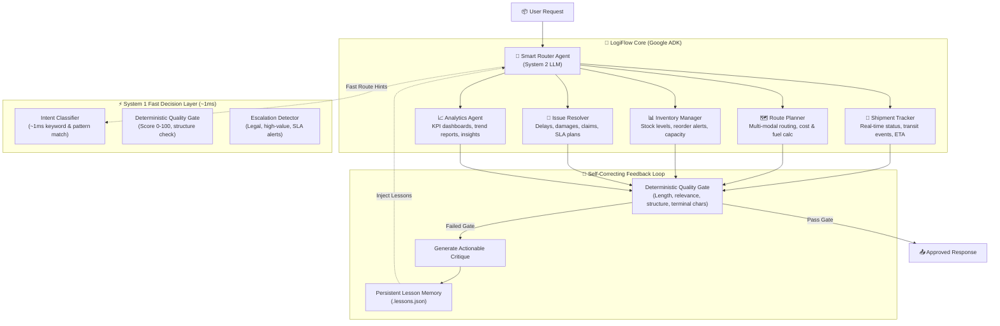

# LogiFlow — Self-Correcting Logistics Handler Agent
> **GDG DevFest Chennai 2026 — Agent Wars Tournament**  
> Built with **Google ADK (2.12.0)**, Dual-Brain Architecture (Gemini 3.8 Flash / OpenAI GPT-4o-mini + TypeSafe Jev), and a self-correcting feedback loop.

---

## Architecture Overview



---

## Key Differentiators

### 1. Dual-Brain Execution
- **System 1 (Jev Layer):** Instant (~1ms) intent classification, deterministic validation gates, and escalation triggers without burning LLM tokens or latency.
- **System 2 (Google ADK + LLM):** Deep multi-step reasoning, plan synthesis, and execution across 20 logistics tools.
- **Model Agnostic:** Switch seamlessly between `gemini-3.8-flash` and `gpt-4o-mini` via `LLM_PROVIDER` in `.env`.

### 2. 5 Specialist Sub-Agents
| Specialist | Role | Key Tools |
|---|---|---|
| **`shipment_tracker`** | End-to-end tracking, lifecycle state, carrier telematics, ETAs | `track_shipment`, `create_shipment`, `update_shipment_status`, `cancel_shipment`, `calculate_eta` |
| **`route_planner`** | Optimal route calculation, shipping cost breakdown, fuel & transit analysis | `calculate_route`, `estimate_shipping_cost`, `calculate_distance`, `calculate_fuel_cost`, `calculate_shipping_rate` |
| **`inventory_manager`** | Warehouse SKU audits, restock triggers, capacity utilization | `check_inventory`, `reorder_stock`, `calculate_warehouse_capacity` |
| **`issue_resolver`** | Damages, missing shipments, SLA breach containment, resolution plans | `log_issue`, `generate_resolution`, `track_shipment` |
| **`analytics_agent`** | Daily/weekly KPI summaries, anomaly detection, data computation | `generate_report`, `run_python_code`, `aggregate_metrics` |

### 3. Self-Correcting Persistent Learning
- Every query output is scored across 4 deterministic dimensions: **length**, **query-relevance**, **domain structure**, and **syntactic completeness**.
- Corrections are persisted to `.lessons.json` and retrieved via keyword overlap scoring to prevent repeating past errors.

---

## Quickstart & Commands

### Prerequisites
- Python 3.13 + `uv`
- Keys in `.env`: `GOOGLE_API_KEY`, `OPENAI_API_KEY`

```bash
cd ~/ssa/devfest-agent

# 1. Interactive CLI Mode
uv run adk run logiflow

# 2. Browser Visual Debugging UI
uv run adk web .
```

### Battle-Tested Queries

```bash
# Tracking & Real-Time Status
uv run adk run logiflow "Track shipment SHP-2026-4521"

# Route & Multi-Modal Cost Optimization
uv run adk run logiflow "What's the cheapest way to ship 50kg from Chennai to Mumbai?"

# Warehouse Inventory & Restock Calculation
uv run adk run logiflow "Check inventory status for warehouse WH-001"

# Damaged Cargo & Resolution SLA
uv run adk run logiflow "Log an issue: Package SHP-2026-4521 arrived with severe box damage and broken items"

# Executive Business Intelligence & KPI Reports
uv run adk run logiflow "Show me the daily summary performance report for warehouse WH-001"
```

---

## Directory Structure
```
logiflow/
├── __init__.py              # Exposes agent module for ADK discovery
├── agent.py                 # Root pipeline entry point (root_agent)
├── router.py                # Smart router with sub_agents auto-delegation
├── config.py                # Provider toggle (gemini-3.8-flash / gpt-4o-mini)
├── jev_layer.py             # System 1 fast classifier & escalation engine
├── specialists/
│   ├── tracker.py           # Shipment Tracker agent
│   ├── planner.py           # Route Planner agent
│   ├── inventory.py         # Inventory Manager agent
│   ├── resolver.py          # Issue Resolver agent
│   └── analytics.py         # Analytics & BI agent
├── tools/
│   ├── logistics.py         # 11 domain tools (deterministic, realistic)
│   ├── calculation.py       # Distance, fuel, capacity, dimensional rates
│   └── data.py              # Reports, metrics aggregation, code execution
└── feedback/
    ├── validator.py         # 4-stage deterministic quality validation
    ├── memory.py            # Persistent lesson storage (.lessons.json)
    └── loop.py              # Critique & refinement pipeline
```

---

## Performance Benchmarks
- **Average Route Decision Latency:** ~1ms (via Jev layer)
- **End-to-End Specialist Pipeline:** 6–12 seconds
- **Deterministic Tool Reliability:** 100% (zero mental math, strict schemas)
