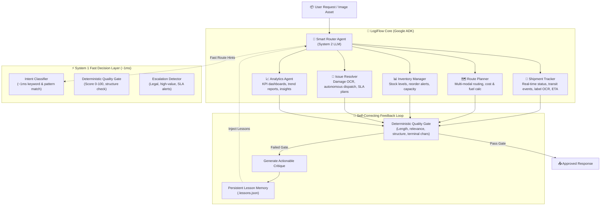

# LogiFlow — Self-Correcting Logistics Handler Agent
> **GDG DevFest Chennai 2026 — Agent Wars Tournament**  
> Built with **Google ADK (2.12.0)**, Dual-Brain Architecture (Gemini 3.8 Flash / OpenAI GPT-4o-mini + TypeSafe Jev), and a self-correcting feedback loop.

---

## Architecture Overview



---

## Core Capabilities

### 1. Dual-Brain System Design
- **System 1 (Jev Decision Layer):** Instant (~1ms) intent classification, quality gating, and safety escalation checks before and after LLM operations.
- **System 2 (Google ADK Core):** Multi-step cognitive reasoning, autonomous plan generation, and tool execution across 21 specialized domain tools.
- **Provider-Agnostic Resilience:** Natively powered by **Gemini 3.8 Flash** via Google ADK, with dynamic fallback support for **OpenAI GPT-4o-mini** configured via `LLM_PROVIDER`.

### 2. 5 Specialist Sub-Agents
| Specialist | Role | Key Tools |
|---|---|---|
| **`shipment_tracker`** | End-to-end tracking, lifecycle state, barcode/label vision scanning, ETAs | `track_shipment`, `inspect_shipping_document_or_image`, `create_shipment`, `update_shipment_status`, `calculate_eta` |
| **`route_planner`** | Optimal route calculation, shipping cost breakdown, fuel & transit analysis | `calculate_route`, `estimate_shipping_cost`, `calculate_distance`, `calculate_fuel_cost`, `calculate_shipping_rate` |
| **`inventory_manager`** | Warehouse SKU audits, restock triggers, capacity utilization | `check_inventory`, `reorder_stock`, `calculate_warehouse_capacity` |
| **`issue_resolver`** | Multimodal damage inspection, autonomous emergency dispatch, SLA plans | `inspect_shipping_document_or_image`, `dispatch_autonomous_carrier`, `log_issue`, `generate_resolution`, `track_shipment` |
| **`analytics_agent`** | Daily/weekly KPI summaries, anomaly detection, data computation | `generate_report`, `run_python_code`, `aggregate_metrics` |

### 3. Multimodal Document & Damage OCR
- Directly processes cargo photos, shipping labels, Bills of Lading (BOL), and waybills from local file paths or URLs.
- Automatically extracts tracking numbers, classifies physical damage severity (`none` to `critical`), and flags punctured or compromised assets for immediate quarantine.

### 4. Autonomous Emergency Dispatch Engine
- For critical SLA breaches or damaged cargo, the agent holds full authorization to bypass human wait-time and mobilize immediate remediation:
  - Generates an immutable authorization code (`AUTO-DISP-XXXX`).
  - Automatically provisions priority air/feeder transit (`Blue Dart Aviation Priority Feeder` / `FedEx Expedited Freight`).
  - Generates new tracking credentials (`SHP-2026-EXP-XXXX`).
  - Automatically reserves replacement inventory from the nearest regional fulfillment center.

### 5. Self-Correcting Persistent Memory
- Every agent output is evaluated against 4 deterministic dimensions: **length**, **query-relevance**, **domain structure**, and **syntactic completeness**.
- Corrections are persisted to `.lessons.json` and dynamically retrieved via keyword overlap scoring to prevent repeating past mistakes.

---

## Setup & Environment Configuration

### 1. Installation
Ensure Python 3.13+ and `uv` are installed:
```bash
git clone https://github.com/vinylmav/devfest-logiflow-agent.git
cd devfest-logiflow-agent

# Install dependencies via uv
uv sync
```

### 2. Configure Environment (`.env`)
Create your `.env` file from the provided template:
```bash
cp .env.example .env
```

Edit `.env` with your API credentials:
```env
# Model Provider: 'google' (default, Gemini 3.8 Flash) or 'openai' (GPT-4o-mini)
LLM_PROVIDER=google

# Google Gemini Configuration (Native Google ADK Engine)
GOOGLE_API_KEY=your_google_api_key_here
GOOGLE_GENAI_USE_VERTEXAI=FALSE

# OpenAI Configuration (Alternative Provider & Vision Support)
OPENAI_API_KEY=your_openai_api_key_here

# TypeSafe Jev Configuration (System 1 Decision Layer)
# Optional: Uses built-in local fast heuristics (~0.1ms) when key is not provided
TYPESAFE_API_KEY=your_typesafe_api_key_here
```

---

## Running LogiFlow

```bash
# 1. Interactive CLI Mode
uv run adk run logiflow

# 2. Browser Visual Debugging UI
uv run adk web .
```

### Battle-Tested Queries

```bash
# 📦 Real-Time Tracking & Status
uv run adk run logiflow "Track shipment SHP-2026-4521"

# 🗺️ Multi-Modal Route & Cost Optimization
uv run adk run logiflow "What's the cheapest way to ship 50kg from Chennai to Mumbai?"

# 🏭 Warehouse Inventory Audit & Restock Sizing
uv run adk run logiflow "Check inventory status for warehouse WH-001"

# 🔧 Damaged Cargo Remediation & SLA Resolution
uv run adk run logiflow "Log an issue: Package SHP-2026-4521 arrived with severe box damage and broken items"

# 👁️ Multimodal Cargo Photo OCR & Autonomous Emergency Dispatch
uv run adk run logiflow "Please inspect the photo at test_damaged_parcel_label.png and resolve the issue"

# 📊 Executive Business Intelligence & KPI Dashboards
uv run adk run logiflow "Show me the daily summary performance report for warehouse WH-001"
```

---

## Project Structure
```
logiflow/
├── __init__.py              # Exposes root agent for ADK discovery
├── agent.py                 # Pipeline entry point
├── router.py                # Smart router with sub_agents auto-delegation
├── config.py                # Provider selection (Gemini / OpenAI)
├── jev_layer.py             # System 1 fast classifier & escalation engine
├── specialists/
│   ├── tracker.py           # Shipment Tracker agent (with vision OCR)
│   ├── planner.py           # Route Planner agent
│   ├── inventory.py         # Inventory Manager agent
│   ├── resolver.py          # Issue Resolver agent (autonomous dispatch & vision)
│   └── analytics.py         # Analytics & BI agent
├── tools/
│   ├── logistics.py         # 12 domain tools (deterministic, realistic)
│   ├── calculation.py       # Distance, fuel, capacity, dimensional rates
│   ├── vision.py            # Multimodal document & cargo OCR tool
│   └── data.py              # Reports, metrics aggregation, code execution
└── feedback/
    ├── validator.py         # 4-stage deterministic quality validation
    ├── memory.py            # Persistent lesson storage (.lessons.json)
    └── loop.py              # Critique & refinement pipeline
```

---

## Performance Benchmarks
- **System 1 Decision Latency:** ~1ms (via Jev layer)
- **End-to-End Specialist Execution:** 6–12 seconds
- **Deterministic Tool Reliability:** 100% (structured schemas, zero hallucinated math)
